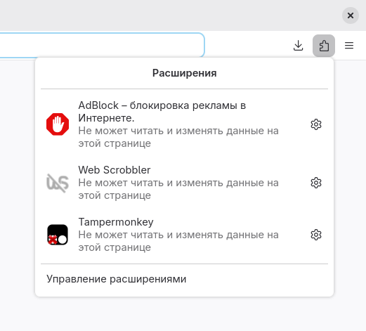
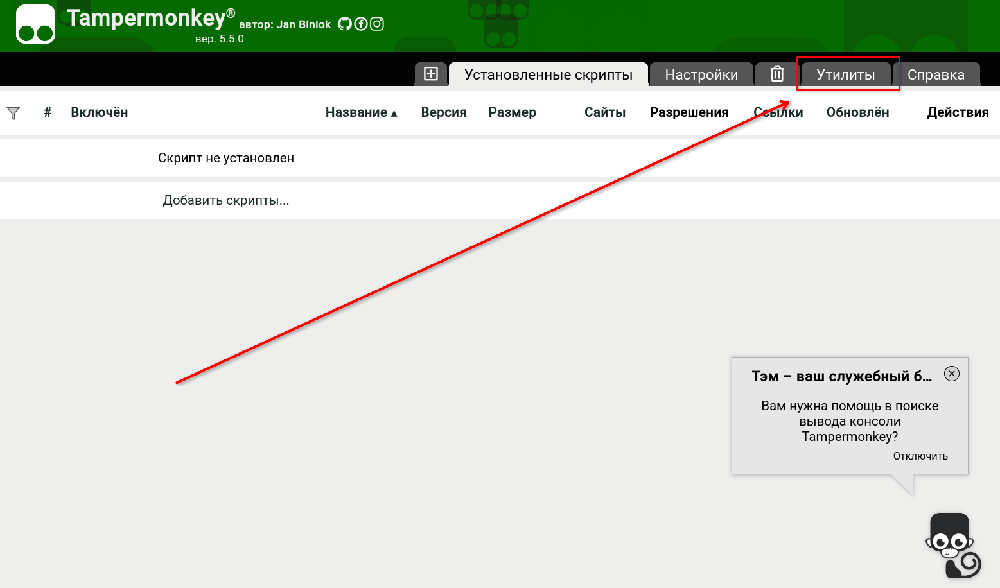

Поставить расширение https://www.tampermonkey.net/
_( НЕ РЕКОМЕНДУЕТСЯ ИСПОЛЬЗОВАТЬ БРАУЗЕРЫ С СЕРТИФИКАТОМ ОТ МИН.ЦИФР, ака. любой отечественный мусор )_

> **Уже стоит старая версия gf-util?** Сначала удалите её: Tampermonkey, "Панель управления", найдите скрипт "GF.util" и удалите его. Если оставить обе версии, они будут конфликтовать.
> Хотите сохранить настройки? Перед удалением откройте старое меню, раздел "Разное", нажмите "Экспорт" и скопируйте текст. После установки v2 вставьте его там же и нажмите "Импорт".

**Скриншоты могут слегка отличаться от того, что вы увидите на экране.** Часть из них сделана для оригинальной версии, интерфейс там тот же, меняются только мелочи:

| На скриншоте | У вас |
| --- | --- |
| Версия gf.util 0.1.0 | Версия новее (0.2.0 и выше) |
| Название скрипта GF.util | GF.util V2 |

Ориентируйтесь на текст и ссылку в инструкции, а не на подписи на картинках.

# Тыкнуть на меню расширений, найти TamperMonkey, кликнуть на него:

# В появившемся окне "Панель управления"

# Утилиты

# В импорт из URL вставляем эту ссылку. Жмём "установить"
```
https://raw.githubusercontent.com/nunemusegan-bot/gf-util-v2/refs/heads/main/script.js
```


# Если вы используете Chromium-подобный браузер - придётся проделать дополнительные действия, ака. предоставление разрешений расширению TamperMonkey. Жмём ПКМ по расширению

# Управление расширениями

# Ищем TamperMonkey. Жмём на "Сведения"

# Выдаём ему ВСЕ разрешения. Можете воспользоваться моим скриншотом, чтобы скопировать настройки

# Если всё сделано правильно - появится ватермарка. Открывать меню настроек на правый SHIFT ( ака. RSHIFT ). Вы устанавливали скрипт на мобильную версию Firefox? Тогда просто нажмите на стартовый тост

