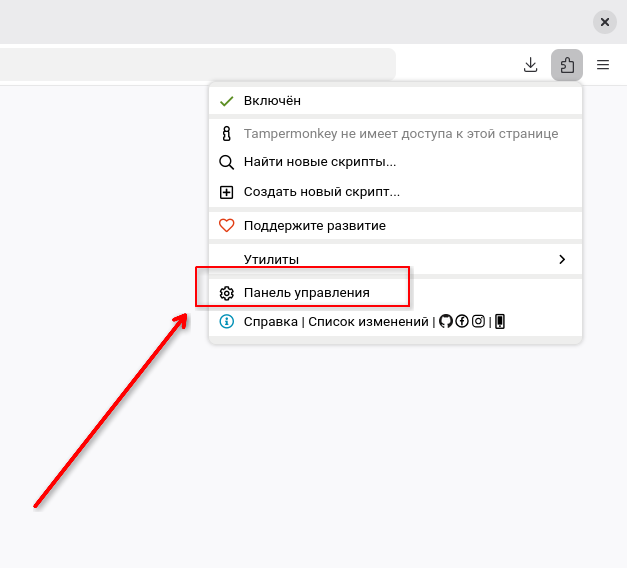
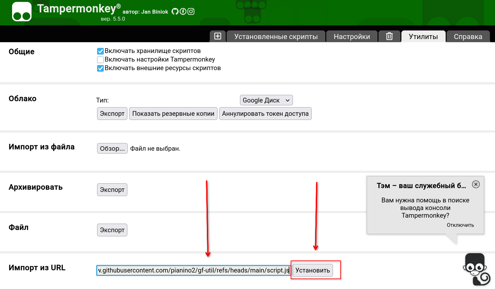
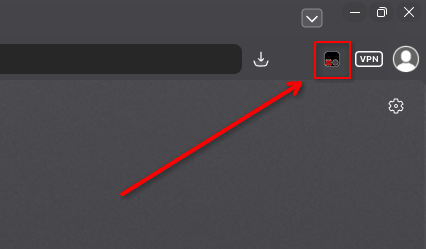
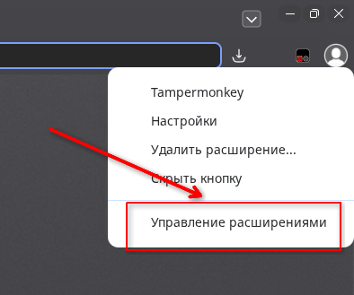
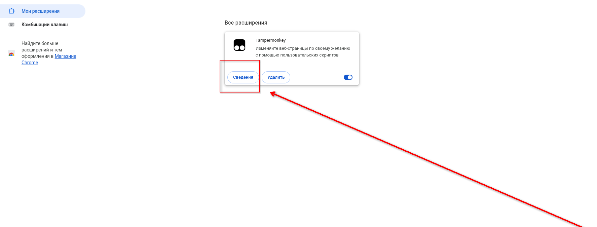
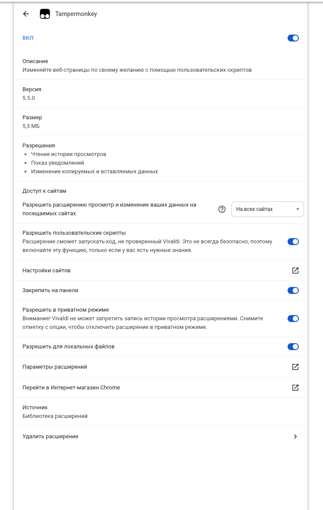

Поставить расширение https://www.tampermonkey.net/
_( НЕ РЕКОМЕНДУЕТСЯ ИСПОЛЬЗОВАТЬ БРАУЗЕРЫ С СЕРТИФИКАТОМ ОТ МИН.ЦИФР, ака. любой отечественный мусор )_

# Тыкнуть на меню расширений, найти TamperMonkey, кликнуть на него:

# В появившемся окне "Панель управления"

# Утилиты

# В импорт из URL вставляем эту ссылку. Жмём "установить"
```
https://raw.githubusercontent.com/pianino2/gf-util/refs/heads/main/script.js
```


# Если вы используете Chromium-подобный браузер - придётся проделать дополнительные действия, ака. предоставление разрешений расширению TamperMonkey. Жмём ПКМ по расширению

# Управление расширениями

# Ищем TamperMonkey. Жмём на "Сведения"

# Выдаём ему ВСЕ разрешения. Можете воспользоваться моим скриншотом, чтобы скопировать настройки

# Если всё сделано правильно - появиться ватермарка. Открывать меню настроек на правый SHIFT ( ака. RSHIFT )
