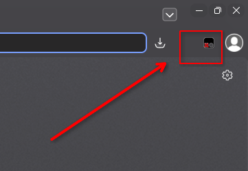
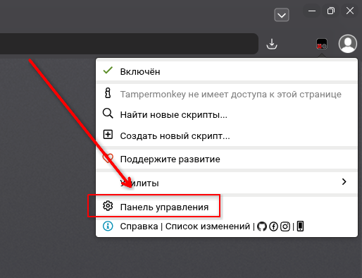
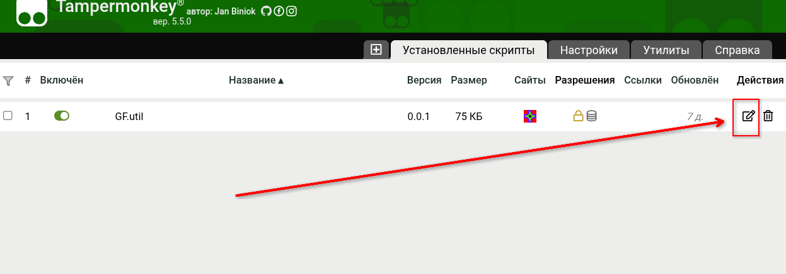
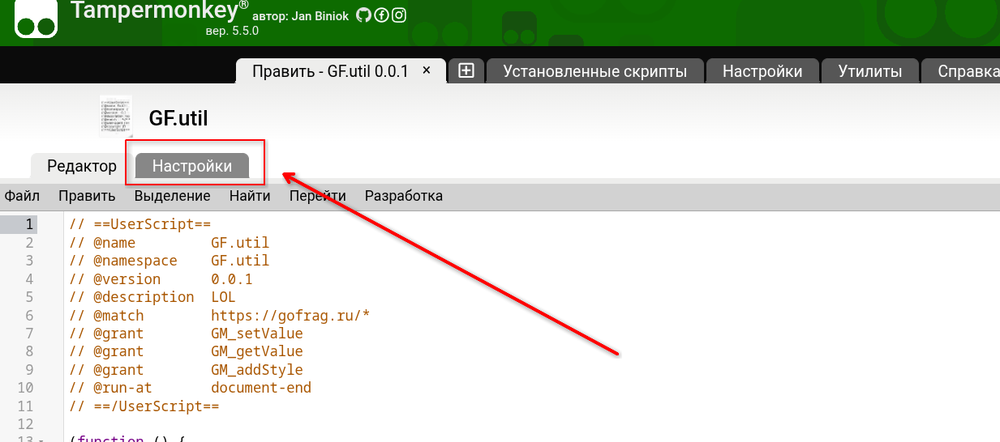
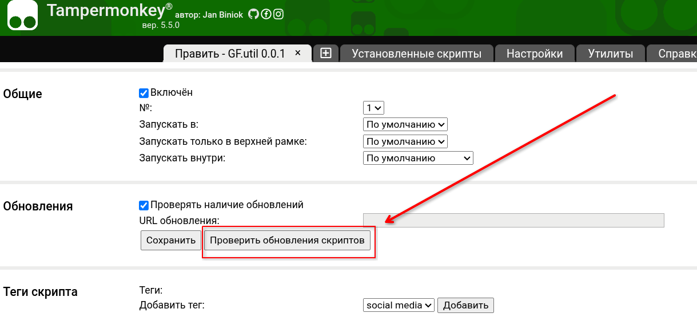

# Инструкцию по ручному обновлению скрипта

**Скриншоты могут слегка отличаться от того, что вы увидите на экране.** Часть из них сделана для оригинальной версии, интерфейс там тот же, меняются только мелочи:

| На скриншоте | У вас |
| --- | --- |
| Версия gf.util 0.1.0 | Версия новее (0.2.0 и выше) |
| Название скрипта GF.util | GF.util V2 |

Ориентируйтесь на текст и ссылку в инструкции, а не на подписи на картинках.
###### 1. Кликнуть по иконке расширения

###### 2. "Панель управления"

###### 3. "Править"

###### 4. "Настройки"

###### 5. "Проверить обновления скриптов"

