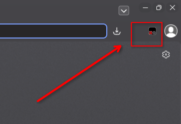
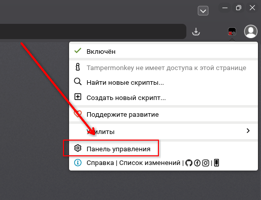
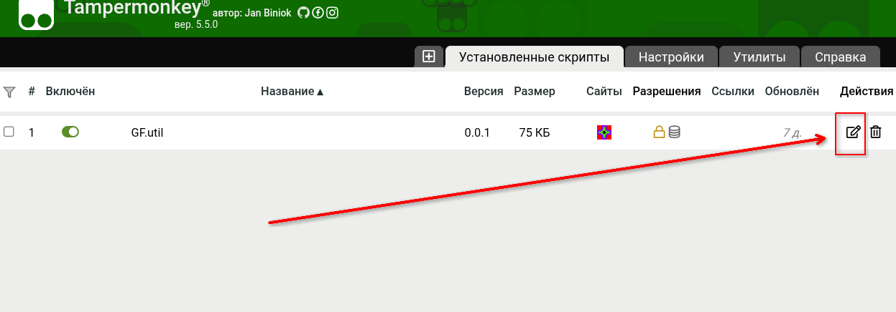
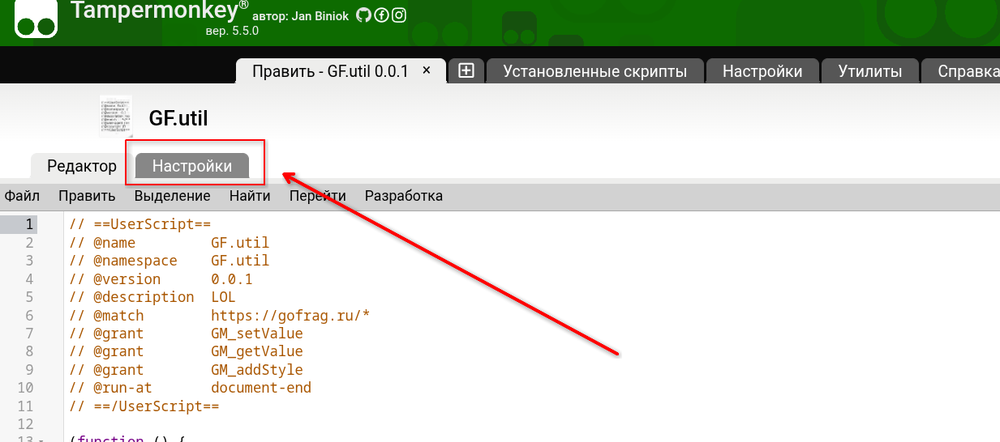
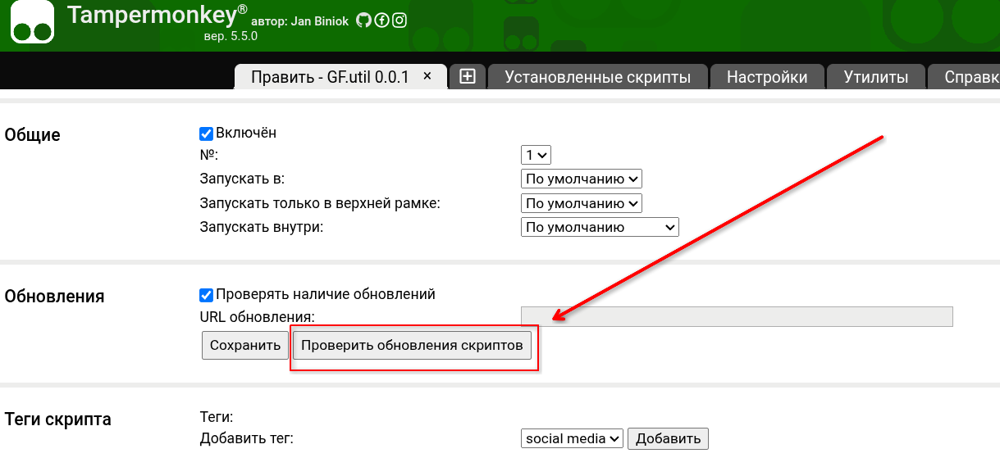

# Инструкцию по ручному обновлению скрипта
###### 1. Кликнуть по иконке расширения

###### 2. "Панель управления"

###### 3. "Править"

###### 4. "Настройки"

###### 5. "Проверить обновления скриптов"
